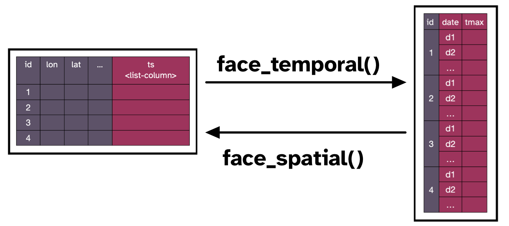

<!-- README.md is generated from README.Rmd. Please edit that file -->

```{r, include = FALSE}
knitr::opts_chunk$set(
  collapse = TRUE,
  comment = "#>",
  fig.path = "man/figures/README-",
  out.width = "100%",
  message = FALSE
)
library(cubble)
```

# cubble <a href='https://huizezhang-sherry.github.io/cubble/'></a>

<!-- badges: start -->
[](https://github.com/huizezhang-sherry/cubble/actions)
[](https://github.com/huizezhang-sherry/cubble/actions/workflows/test.yaml)
<!-- badges: end -->

The term spatio-temporal data can incorporate various spatial and temporal characteristics and different data may require different data structures for wrangling and analysis. The spatio-temporal data that cubble addresses are those collected at unique fixed locations, allowing for irregularity in the temporal dimension, such as the weather station data. 

Beyond data wrangling, cubble makes glyph maps native to ggplot2: `geom_glyph()` draws each location's time series as a small plot at that location, so spatial and temporal patterns can be seen in a single plot.

## Installation

You can install the released version of cubble from [CRAN](https://CRAN.R-project.org) with:

``` r
install.packages("cubble")
```

And the development version from [GitHub](https://github.com/) with:

``` r
# install.packages("remotes")
remotes::install_github("huizezhang-sherry/cubble")
```

## How cubble organises spatio-temporal data

Cubble organises spatio-temporal data in two structures: In a nested cubble (spatial cubble), spatial variables are organised as columns and temporal variables are nested within a specialised `ts` column: 

```{r echo = FALSE}
climate_mel
```

In a long cubble (temporal cubble), the temporal variables are expanded into the long form, while the spatial variables are stored as a data attribute: 

```{r echo = FALSE}
climate_mel |> face_temporal()
```

The two forms can be pivoted back and forth with the pair of verb: `face_spatial()` and `face_temporal()`.

```{r echo = FALSE, out.width="80%", fig.align='center'}

```


## Glyph maps

A glyph map draws each location's time series as a small plot, a glyph, at that location. cubble provides `geom_glyph()`, with `geom_glyph_box()` and `geom_glyph_line()` for reference boxes and lines, as ggplot2 layers. They take four aesthetics: `x_major` and `y_major` for the location, and `x_minor` and `y_minor` for the time series inside each glyph. Below, each glyph shows the proportion of water samples above the bacteria guideline in the 0–6 days after heavy rain at Sydney swim sites: ocean beaches clear within two days, while inner harbour sites stay polluted for longer.

```{r glyph-map, fig.width = 6, fig.height = 7.5, out.width = "70%", fig.align = "center"}
library(ggplot2)
beach <- read.csv(system.file("extdata/sydney-beach.csv", package = "cubble"))
sydney <- sf::st_read(system.file("extdata/sydney-land.geojson", package = "cubble"), 
                      quiet = TRUE)

ggplot(beach, aes(x_major = long, y_major = lat,
                  x_minor = days_after_rain, y_minor = unsafe,
                  colour = water, group = swim_site)) +
  geom_sf(data = sydney, fill = "#ECEAE4", colour = NA, inherit.aes = FALSE) +
  geom_glyph_box(width = 0.028, height = 0.012, colour = "#9CADB7") +
  geom_glyph(width = 0.028, height = 0.012, linewidth = 0.6, key_glyph = "path") +
  scale_colour_manual(values = c("#BF5700", "#005F86"), name = NULL) +
  coord_sf(xlim = c(151.11, 151.32), ylim = c(-34.0, -33.72)) +
  theme_void() +
  theme(legend.position = "bottom",
        panel.background = element_rect(fill = "#e8f3ff", colour = NA))
```

For summaries that are an interval rather than a single value, such as the daily minimum and maximum temperature, the [sugarglider](https://www.malinypo.com/sugarglider/) package extends cubble's glyph maps with `geom_glyph_segment()` and `geom_glyph_ribbon()`. 

## Roadmap

  * To learn about the cubble class, how to create a cubble or coerce an existing R object into a cubble, and how to incorporate sf or tsibble in a cubble: [1. The cubble class](https://huizezhang-sherry.github.io/cubble/articles/cb1class.html)
  * To match multiple data sources: [2. Application: matching different data sources](https://huizezhang-sherry.github.io/cubble/articles/cb2match.html)
  * To make glyph maps: 
    * why glyph maps are useful and the `geom_glyph()` syntax: [3. Visualization: glyph map basics](https://huizezhang-sherry.github.io/cubble/articles/cb3glyph.html)
    * a worked example with Sydney beach water quality: [4. Visualization: glyph map examples](https://huizezhang-sherry.github.io/cubble/articles/cb4glyphexample.html)
    * interval glyphs (segments and ribbons): the [sugarglider](https://www.malinypo.com/sugarglider/) package
  * To create interactive graphics with cubble: [5. Visualization: interactive graphics](https://huizezhang-sherry.github.io/cubble/articles/cb5interactive.html)
