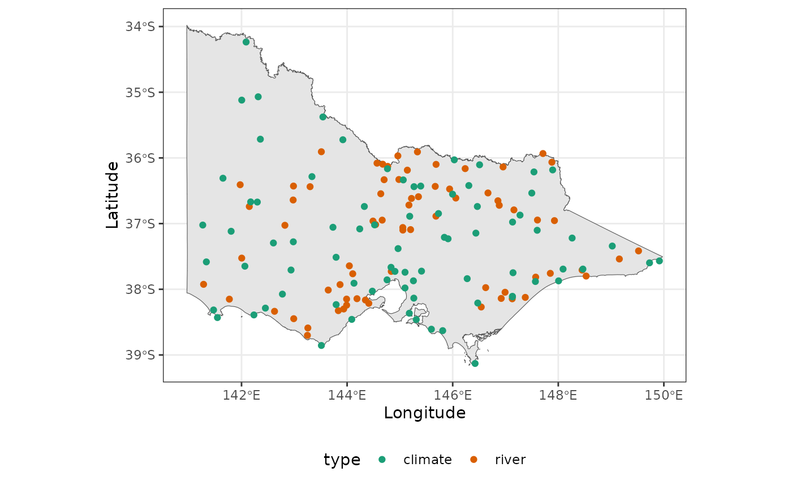
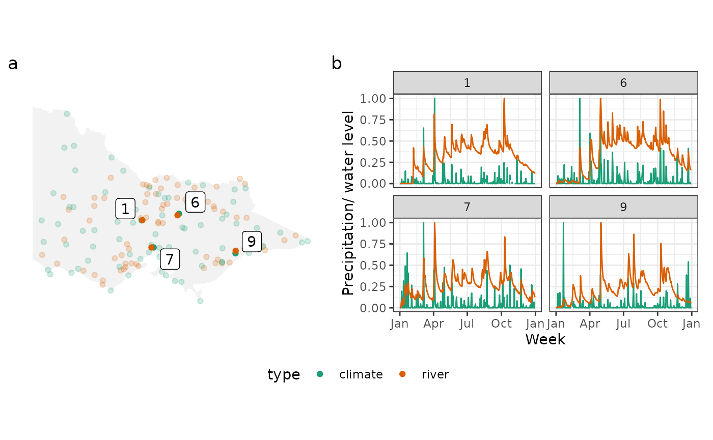

# 2. Application: matching different data sources

One common task when working with spatio-temporal data is to match
nearby sites. For example, we may want to verify the location of an old
list of stations with current stations, or we may want to match the data
from different data sources. In this vignette, we will introduce the
spatial and temporal matching in cubble using an example on matching
river level data with precipitation in Victoria, Australia.

In cubble, spatial and temporal matching are performed using the
functions
[`match_spatial()`](https://huizezhang-sherry.github.io/cubble/reference/matching.md)
and
[`match_temporal()`](https://huizezhang-sherry.github.io/cubble/reference/matching.md).
The
[`match_spatial()`](https://huizezhang-sherry.github.io/cubble/reference/matching.md)
function calculates the spatial distance between observations in two
cubble objects. Various distance measures are available (check
[`sf::st_distance`](https://r-spatial.github.io/sf/reference/geos_measures.html)).
Analysts can specify the number of matched groups to output using the
`spatial_n_group` argument (default to 4 groups) and the number of
matches per group using the `spatial_n_group` argument (default to 1,
one-to-one matching). The syntax to use
[`match_spatial()`](https://huizezhang-sherry.github.io/cubble/reference/matching.md)
is:

    match_spatial(<cubble_obj1>, <cubble_obj2>, ...)

The function
[`match_temporal()`](https://huizezhang-sherry.github.io/cubble/reference/matching.md)
calculates the similarity between time series within spatially matched
groups. Two identifiers are required: one for separating each matched
group (`match_id`) and one for separating the two data sources
(`data_id`). The argument `temporal_by` uses the `by` syntax from
dplyr’s `*_join` to specify the temporal variables to match.

The similarity score between two time series is calculated using a
matching function, which can be customised by the analysts. The matching
function takes two time series as a list and returns a single numerical
score. This allows for flexibility in using existing time series
distance calculation implementation. By default, cubble implements a
simple peak matching algorithm (`match_peak`) that counts the number of
peaks in two time series that fall within a specified temporal window.
The syntax to use
[`match_temporal()`](https://huizezhang-sherry.github.io/cubble/reference/matching.md)
is

    match_temporal(
      <cubble_obj_from_match_spatial>, 
      data_id = , match_id = , 
      temporal_by = c("..." = "...")
    )

## Spatial matching

Now let’s consider an example of matching water data from river gauges
with precipitation. The [water level
data](http://www.bom.gov.au/metadata/catalogue/19115/ANZCW0503900528?template=full),
collected by the Bureau of Meteorology, can be compared with the
precipitation since rainfall can directly impact water level in river.
Here is the location of available weather stations and water gauges in
Victoria, Australia:



Both `climate_vic` and `river` are cubble objects, and we can obtain a
summary of the 10 closest pairs between them:

``` r

(res_sp <- match_spatial(climate_vic, river, spatial_n_group = 10))
#> # A tibble: 10 × 4
#>    from        to      dist group
#>    <chr>       <chr>    [m] <int>
#>  1 ASN00088051 406213 1838.     1
#>  2 ASN00084145 222201 2185.     2
#>  3 ASN00085072 226027 3282.     3
#>  4 ASN00080015 406704 4034.     4
#>  5 ASN00085298 226027 4207.     5
#>  6 ASN00082042 405234 6153.     6
#>  7 ASN00086038 230200 6167.     7
#>  8 ASN00086282 230200 6928.     8
#>  9 ASN00085279 224217 7431.     9
#> 10 ASN00080091 406756 7460.    10
```

The result can also be returned as cubble objects by setting the
argument `return_cubble = TRUE`. The output is be a list where each
element is a paired cubble object. To combine all the results into a
single cubble, you can use
[`bind_rows()`](https://dplyr.tidyverse.org/reference/bind_rows.html).
In the case when a site in the second cubble (the `river` data here) is
matched to two stations in the first cubble (`climate_vic` here), the
binding may not be successful since cubble requires unique rows in the
nested form. In the summary table above, the river station `226027` is
matched to more than one weather station: `ASN00085072` (group 3) and
`ASN00085298` (group 5). Similarly, the river station `230200` is
matched in group 7 and 8). In such cases, you can either deselect one
pair before combining, or work with the list output with the
[`purrr::map`](https://purrr.tidyverse.org/reference/map.html) syntax:

``` r

res_sp <- match_spatial(climate_vic, river, spatial_n_group = 10, return_cubble = TRUE)
str(res_sp, max.level = 0)
#> List of 10
res_sp[[1]]
#> # cubble:   key: id [2], index: date, nested form, [sf]
#> # spatial:  [144.52, -37.02, 144.54, -37.02], WGS 84 (CRS84)
#> # temporal: date [date], prcp [dbl], tmax [dbl], tmin [dbl]
#>   id           long   lat  elev name           wmo_id ts       type  group  dist
#>   <chr>       <dbl> <dbl> <dbl> <chr>           <dbl> <list>   <chr> <int>   [m]
#> 1 ASN00088051  145. -37.0   290 redesdale       94859 <tibble> clim…     1   NA 
#> 2 406213       145. -37.0    NA CAMPASPE RIVE…     NA <tibble> river     1 1838.
#> # ℹ 1 more variable: geometry <POINT [°]>
(res_sp <- res_sp[-c(5, 8)] |> bind_rows())
#> # cubble:   key: id [16], index: date, nested form, [sf]
#> # spatial:  [144.52, -38.14, 148.47, -36.13], WGS 84 (CRS84)
#> # temporal: date [date], prcp [dbl], tmax [dbl], tmin [dbl]
#>    id           long   lat  elev name          wmo_id ts       type  group  dist
#>    <chr>       <dbl> <dbl> <dbl> <chr>          <dbl> <list>   <chr> <int>   [m]
#>  1 ASN00088051  145. -37.0 290   redesdale      94859 <tibble> clim…     1   NA 
#>  2 406213       145. -37.0  NA   CAMPASPE RIV…     NA <tibble> river     1 1838.
#>  3 ASN00084145  148. -37.7  62.7 orbost         95918 <tibble> clim…     2   NA 
#>  4 222201       148. -37.7  NA   SNOWY RIVER …     NA <tibble> river     2 2185.
#>  5 ASN00085072  147. -38.1   4.6 east sale ai…  94907 <tibble> clim…     3   NA 
#>  6 226027       147. -38.1  NA   LA TROBE RIV…     NA <tibble> river     3 3282.
#>  7 ASN00080015  145. -36.2  96   echuca  aero…  94861 <tibble> clim…     4   NA 
#>  8 406704       145. -36.1  NA   DEAKIN MAIN …     NA <tibble> river     4 4034.
#>  9 ASN00082042  146. -36.8 502   strathbogie    95843 <tibble> clim…     6   NA 
#> 10 405234       146. -36.9  NA   SEVEN CREEKS…     NA <tibble> river     6 6153.
#> 11 ASN00086038  145. -37.7  78.4 essendon air…  95866 <tibble> clim…     7   NA 
#> 12 230200       145. -37.7  NA   MARIBYRNONG …     NA <tibble> river     7 6167.
#> 13 ASN00085279  148. -37.9  49.4 bairnsdale a…  94912 <tibble> clim…     9   NA 
#> 14 224217       148. -37.8  NA   MITCHELL RIV…     NA <tibble> river     9 7431.
#> 15 ASN00080091  145. -36.3 105   kyabram dpi    95833 <tibble> clim…    10   NA 
#> 16 406756       145. -36.3  NA   MOSQUITO CRE…     NA <tibble> river    10 7460.
#> # ℹ 1 more variable: geometry <POINT [°]>
```

## Temporal matching

For temporal matching, we match the variable `Water_course_level` from
the river data to `prcp` in the weather station data. The variable
`group` and `types` identify the matching group and the two datasets:

``` r

(res_tm <- res_sp |> 
  match_temporal(
    data_id = type, match_id = group,
    temporal_by = c("prcp" = "Water_course_level")))
#> # A tibble: 8 × 2
#>   group match_res
#>   <int>     <dbl>
#> 1     1        30
#> 2     2         5
#> 3     3        14
#> 4     4        20
#> 5     6        23
#> 6     7        26
#> 7     9        21
#> 8    10        14
```

Similarly, the cubble output can be returned using the argument
`return_cubble = TRUE`. Here we select the four pairs with the highest
number of matching peaks:

``` r

res_tm <- res_sp |> 
  match_temporal(
    data_id = type, match_id = group,
    temporal_by = c("prcp" = "Water_course_level"),
    return_cubble = TRUE)
(res_tm <- res_tm |> bind_rows() |> filter(group %in% c(1, 7, 6, 9)))
#> # cubble:   key: id [8], index: date, nested form, [sf]
#> # spatial:  [144.52, -37.88, 147.57, -36.85], WGS 84 (CRS84)
#> # temporal: date [date], matched [dbl]
#>   id          long   lat  elev name  wmo_id type  group  dist ts       match_res
#>   <chr>      <dbl> <dbl> <dbl> <chr>  <dbl> <chr> <int>   [m] <list>       <dbl>
#> 1 ASN000880…  145. -37.0 290   rede…  94859 clim…     1   NA  <tibble>        30
#> 2 406213      145. -37.0  NA   CAMP…     NA river     1 1838. <tibble>        30
#> 3 ASN000820…  146. -36.8 502   stra…  95843 clim…     6   NA  <tibble>        23
#> 4 405234      146. -36.9  NA   SEVE…     NA river     6 6153. <tibble>        23
#> 5 ASN000860…  145. -37.7  78.4 esse…  95866 clim…     7   NA  <tibble>        26
#> 6 230200      145. -37.7  NA   MARI…     NA river     7 6167. <tibble>        26
#> 7 ASN000852…  148. -37.9  49.4 bair…  94912 clim…     9   NA  <tibble>        21
#> 8 224217      148. -37.8  NA   MITC…     NA river     9 7431. <tibble>        21
#> # ℹ 1 more variable: geometry <POINT [°]>
```

And then we can visualise them in space or across time:


