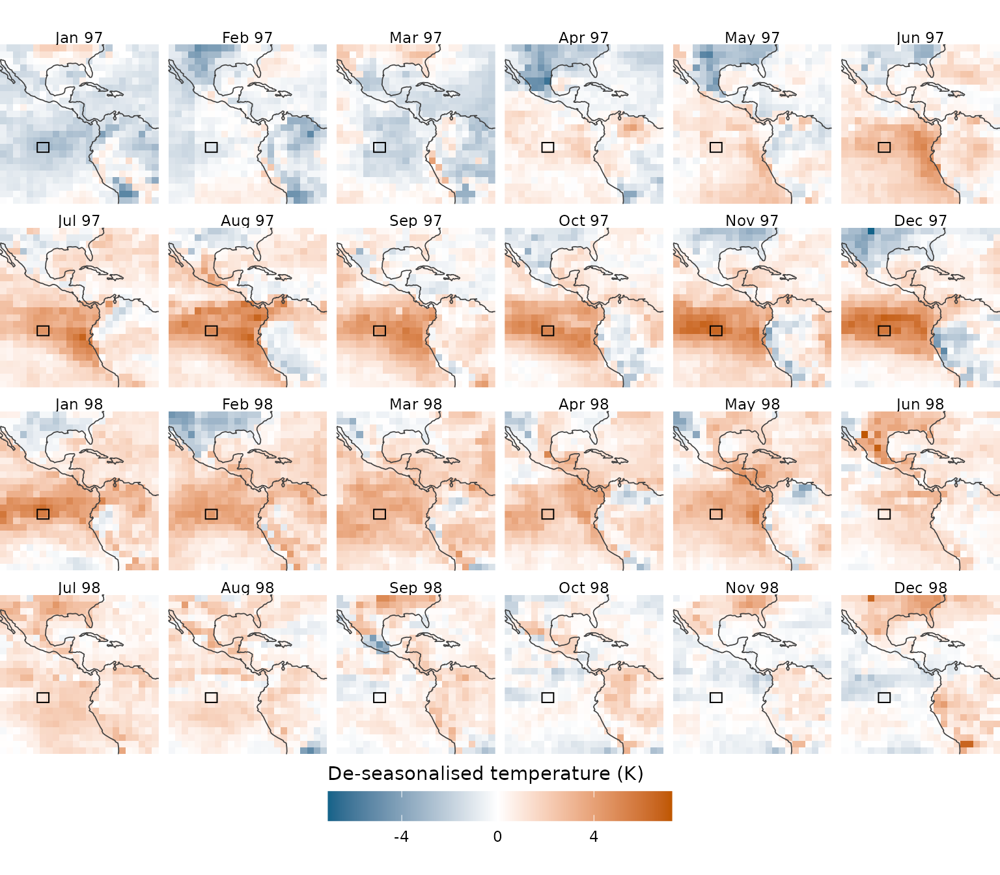
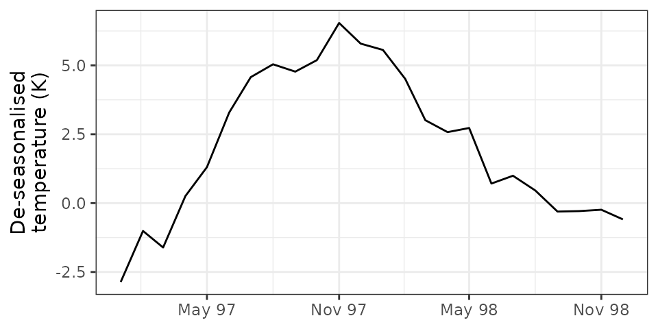
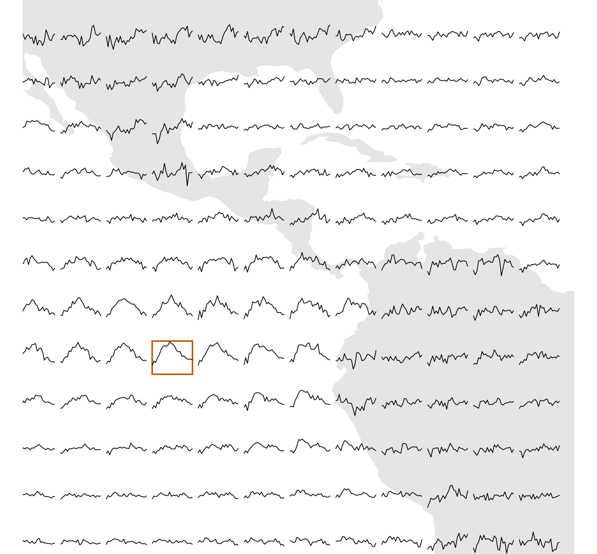
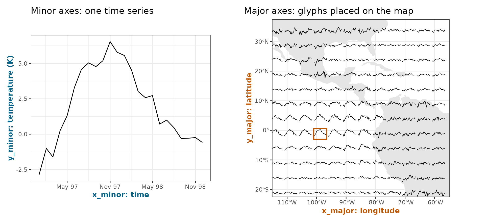

# 3. Visualization: glyph map basics

Environmental data often come as many time series recorded at many
locations, and a common way to display them is a series of maps faceted
by time. This vignette shows why such data can benefit from a glyph map,
which draws each location’s time series as a small plot at that
location, and how to make one with
[`geom_glyph()`](https://huizezhang-sherry.github.io/cubble/reference/glyph.md).
More examples of glyph maps are in [4. Visualization: glyph map
examples](https://huizezhang-sherry.github.io/cubble/articles/cb4glyphexample.html).
Interactive graphics, another way to link maps and time series, are
covered in [5. Visualization: interactive
graphics](https://huizezhang-sherry.github.io/cubble/articles/cb5interactive.html).

## Why glyph maps?

### From facets to a glyph map

The `nasa` data from the GGally package records monthly atmospheric
measurements on a 24 x 24 grid over Central America from 1995 to 2000.
Below we remove the trend and the seasonal pattern from the surface
temperature in each grid cell and show the de-seasonalised temperature
for 1997 and 1998, one map per month:

Faceted maps are good at showing the spatial pattern within a month, but
it is hard to see how a single location changes over time. To get the
time series of the boxed cell, you need to follow it through all 24
panels:

A glyph map (Wickham et al. 2012) draws this time series as a small plot
at the cell’s location. Doing this for every location (here, every other
grid cell in each direction, so that the glyphs don’t overlap) gives the
full glyph map:

### What the glyph map shows

Some patterns can be seen in both displays. The 1997–98 El Niño, the
warming of the eastern Pacific, is clear in the faceted maps as the band
of warm cells along the equator in late 1997, and in the glyph map as
the single hump shared by the glyphs in the equatorial eastern Pacific,
which rises through 1997, peaks in late 1997, and falls back in 1998.
Other patterns are much easier to see in the glyph map. The glyphs over
land vary much more from month to month than those over the sea, where
the temperature changes smoothly over time. This difference is hard to
see in the faceted maps, since it requires comparing how each cell
changes from one panel to the next. Because each glyph shows the full
time series at its location, a glyph map lets you see the spatial and
temporal patterns at once.

## The glyph map syntax

Glyph maps were first implemented in the GGally package, where
[`GGally::glyphs()`](https://ggobi.github.io/ggally/reference/glyphs.html)
computes the glyph coordinates as a separate data step before plotting.
cubble now makes glyph maps native to ggplot2 by providing a ggplot2
extension,
[`geom_glyph()`](https://huizezhang-sherry.github.io/cubble/reference/glyph.md),
and associated tools,
[`geom_glyph_box()`](https://huizezhang-sherry.github.io/cubble/reference/glyph.md)
and
[`geom_glyph_line()`](https://huizezhang-sherry.github.io/cubble/reference/glyph.md),
so a glyph map can be built layer by layer like any other ggplot.

### `geom_glyph()` and its four aesthetics

The underlying idea of a glyph map is to transform the temporal
coordinates into spatial coordinates, so that a time series plot can be
displayed on the map. In cubble,
[`geom_glyph()`](https://huizezhang-sherry.github.io/cubble/reference/glyph.md)
performs this transformation internally (Equation 1 in Wickham et al.
(2012)) and requires four aesthetics:

- `x_major` and `y_major`: the spatial coordinates of each location,
  e.g. longitude and latitude, which place the glyph on the map, and
- `x_minor` and `y_minor`: the coordinates of the time series inside the
  glyph, e.g. time and the measured variable.

&nbsp;

    data |> 
      ggplot() +
      geom_glyph(aes(x_major = ..., y_major = ..., x_minor = ..., y_minor = ...))

The figure below illustrates the two sets of axes with the boxed grid
cell from the glyph map above. On the left is its time series, drawn on
the minor axes: time on `x_minor` and the de-seasonalised temperature on
`y_minor`. On the right,
[`geom_glyph()`](https://huizezhang-sherry.github.io/cubble/reference/glyph.md)
rescales this time series into a box of the given `width` and `height`,
and places the box on the map, centred at the cell’s longitude
(`x_major`) and latitude (`y_major`), as the boxed glyph in the full
glyph map. The shape of the time series remains unchanged, so each glyph
can be read as a small time series plot at its location:

### Reference boxes and lines

A reference box around each glyph and a reference line through its
middle can be added with
[`geom_glyph_box()`](https://huizezhang-sherry.github.io/cubble/reference/glyph.md)
and
[`geom_glyph_line()`](https://huizezhang-sherry.github.io/cubble/reference/glyph.md).
Since all three geoms use the same four aesthetics, we recommend
specifying the aesthetics once, inside
[`ggplot()`](https://ggplot2.tidyverse.org/reference/ggplot.html):

    data |> 
      ggplot(aes(x_major = ..., y_major = ..., x_minor = ..., y_minor = ...)) +
      geom_glyph_box() + 
      geom_glyph_line() + 
      geom_glyph()

### Adding other layers

With the glyph aesthetics specified in
[`ggplot()`](https://ggplot2.tidyverse.org/reference/ggplot.html), every
other layer will inherit them. For layers that don’t use the four glyph
aesthetics, such as an underlying map drawn with
[`geom_sf()`](https://ggplot2.tidyverse.org/reference/ggsf.html), set
`inherit.aes = FALSE`:

    data |> 
      ggplot(aes(x_major = ..., y_major = ..., x_minor = ..., y_minor = ...)) +
      geom_sf(data = MAP_DATA, inherit.aes = FALSE) +
      geom_glyph_box() + 
      geom_glyph_line() + 
      geom_glyph()

### Everything else in ggplot2

Since
[`geom_glyph()`](https://huizezhang-sherry.github.io/cubble/reference/glyph.md)
is a ggplot2 layer, everything else in the ggplot2 framework works as
usual. For example, you can map a variable to colour with
`aes(colour = ...)`, change the colours with a `scale_colour_*()`
function, and customise the look of the plot with
[`theme()`](https://ggplot2.tidyverse.org/reference/theme.html):

    data |> 
      ggplot(aes(x_major = ..., y_major = ..., x_minor = ..., y_minor = ..., 
                 colour = ..., group = ...)) +
      geom_sf(data = MAP_DATA, inherit.aes = FALSE) +
      geom_glyph_box() + 
      geom_glyph() + 
      scale_colour_brewer(...) + 
      theme(...)

When mapping a discrete variable to colour, also set `group` to the
location ID, so that each location is drawn as its own glyph rather than
one line per colour. See [4. Visualization: glyph map
examples](https://huizezhang-sherry.github.io/cubble/articles/cb4glyphexample.html)
for a full example.

## Reference

Wickham, Hadley, Heike Hofmann, Charlotte Wickham, and Dianne Cook.
2012. “Glyph-Maps for Visually Exploring Temporal Patterns in Climate
Data and Models.” *Environmetrics* 23 (5): 382–93.
<https://doi.org/10.1002/env.2152>.
