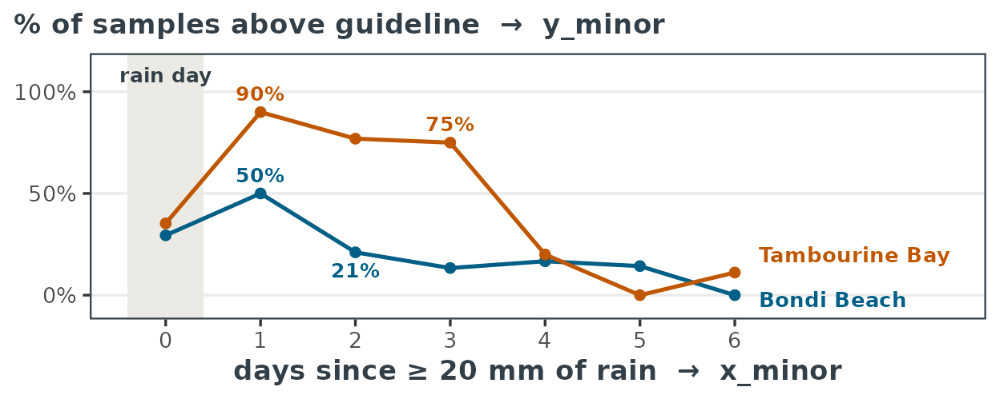
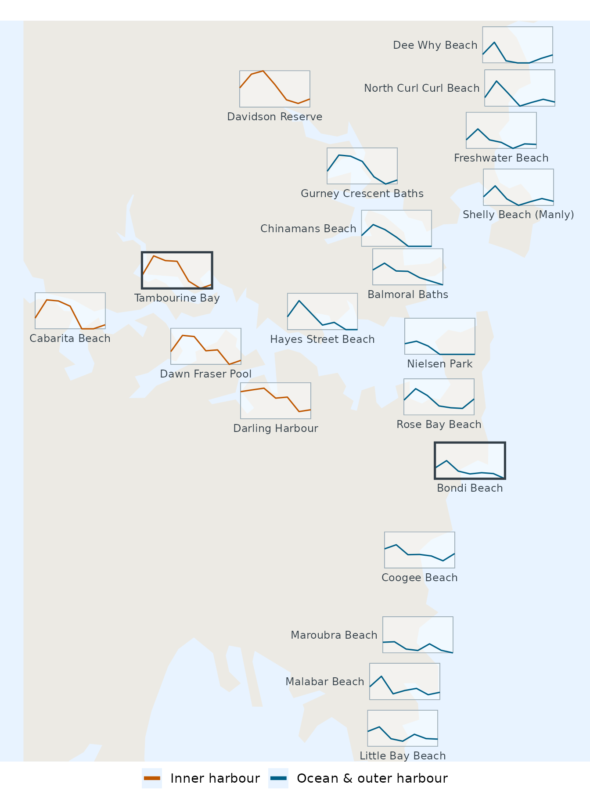

# 4. Visualization: glyph map examples

``` r

library(cubble)
library(dplyr)
library(ggplot2)
```

This vignette collects examples of glyph maps made with cubble. The
syntax used here is introduced in [3. Visualization: glyph map
basics](https://huizezhang-sherry.github.io/cubble/articles/cb3glyph.html).

## How long after a storm is it safe to swim in Sydney?

Heavy rain washes stormwater and sewage overflow into the sea, so
beaches can be unsafe for swimming for some days after a storm. NSW
Beachwatch monitors the water quality at swim sites across Sydney,
measuring enterococci, a bacteria that indicates faecal pollution. The
data, together with Sydney’s daily rainfall, were featured in
[TidyTuesday on
2025-05-20](https://github.com/rfordatascience/tidytuesday/tree/main/data/2025/2025-05-20).

We matched each water sample from 2015 onwards to the most recent day
with at least 20 mm of rain, a “very heavy rain” day in the ETCCDI
climate-extremes indices, which gives the number of days since rain when
the sample was taken (0 to 6). For each site and each number of days, we
then calculated the proportion of samples above 40 enterococci per 100
mL, the limit for the best water-quality grade in Australia’s guidelines
for recreational water (NHMRC, 2008). The sites are grouped into the
inner harbour (Sydney Harbour sites at least 7 km from the harbour
entrance) and the ocean and outer harbour, and only sites whose glyphs
don’t overlap are kept. The code for these steps is in
`data-raw/sydney-beach.R` in the cubble GitHub repository, and the
result is shipped with the package:

``` r

beach <- read.csv(system.file("extdata/sydney-beach.csv", package = "cubble"))
as_tibble(beach)
#> # A tibble: 140 × 8
#>    swim_site      region          long   lat days_after_rain unsafe     n water 
#>    <chr>          <chr>          <dbl> <dbl>           <int>  <dbl> <int> <chr> 
#>  1 Balmoral Baths Sydney Harbour  151. -33.8               0  0.412    17 Ocean…
#>  2 Balmoral Baths Sydney Harbour  151. -33.8               1  0.6      10 Ocean…
#>  3 Balmoral Baths Sydney Harbour  151. -33.8               2  0.385    13 Ocean…
#>  4 Balmoral Baths Sydney Harbour  151. -33.8               3  0.375     8 Ocean…
#>  5 Balmoral Baths Sydney Harbour  151. -33.8               4  0.2       5 Ocean…
#>  6 Balmoral Baths Sydney Harbour  151. -33.8               5  0.1      10 Ocean…
#>  7 Balmoral Baths Sydney Harbour  151. -33.8               6  0         9 Ocean…
#>  8 Bondi Beach    Sydney City     151. -33.9               0  0.294    17 Ocean…
#>  9 Bondi Beach    Sydney City     151. -33.9               1  0.5      12 Ocean…
#> 10 Bondi Beach    Sydney City     151. -33.9               2  0.210    19 Ocean…
#> # ℹ 130 more rows
```

Before making the glyph map, let’s look at two sites in an ordinary line
plot. These are the time series that the glyphs will draw: the number of
days since rain on the x-axis, which will be `x_minor`, and the
proportion of unsafe samples on the y-axis, which will be `y_minor`:



Both sites are most polluted on the day after the storm. Bondi Beach, on
the ocean, then clears quickly: only about one in five samples is above
the guideline by the second day. Tambourine Bay, deep in the inner
harbour, stays polluted for three days, with three in four samples above
the guideline, before it clears on the fourth day.

To compare all the sites, we draw each site’s line plot as a glyph at
its location. The glyph aesthetics are specified once in
[`ggplot()`](https://ggplot2.tidyverse.org/reference/ggplot.html),
together with `colour` and `group`, and are used by both
[`geom_glyph_box()`](https://huizezhang-sherry.github.io/cubble/reference/glyph.md)
and
[`geom_glyph()`](https://huizezhang-sherry.github.io/cubble/reference/glyph.md).
The land and the site names don’t use the glyph aesthetics, so they are
added with `inherit.aes = FALSE`. The two sites above are boxed:

``` r

sydney <- sf::st_read(
  system.file("extdata/sydney-land.geojson", package = "cubble"),
  quiet = TRUE)
gw <- 0.028; gh <- 0.012   # glyph width and height (degrees)

# tightest extent around the glyph boxes and the names under them
xl <- range(beach$long) + c(-2, 2) * gw / 2
yl <- range(beach$lat) + c(-0.011, gh / 2 + 0.002)
eg_box <- distinct(eg, long, lat)   # the two sites above

# site names go under the glyph, or to its left when the glyph below
# would overlap the name
sites <- distinct(beach, swim_site, long, lat)
site_names <- sites |>
  rowwise() |>
  mutate(left = any(abs(long - sites$long) < gw &
                      lat - sites$lat > 0 & lat - sites$lat < gh / 2 + 0.011)) |>
  ungroup()

ggplot(beach, aes(x_major = long, y_major = lat,
                  x_minor = days_after_rain, y_minor = unsafe,
                  colour = water, group = swim_site)) +
  geom_sf(data = sf::st_crop(sydney, xmin = xl[1], xmax = xl[2],
                             ymin = yl[1], ymax = yl[2]),
          fill = pal$base, colour = NA, inherit.aes = FALSE) +   # land
  geom_glyph_box(width = gw, height = gh, colour = pal$grid, fill = "white",
                 alpha = 0.08, linewidth = 0.2) +
  geom_glyph(width = gw, height = gh, linewidth = 0.55, key_glyph = "path") +
  annotate("rect", xmin = eg_box$long - gw / 2, xmax = eg_box$long + gw / 2,
           ymin = eg_box$lat - gh / 2, ymax = eg_box$lat + gh / 2,
           fill = NA, colour = pal$ink, linewidth = 0.9) +
  geom_text(data = filter(site_names, !left),   # site names
            aes(x = long, y = lat - 0.009, label = swim_site),
            inherit.aes = FALSE, size = 3.2, colour = pal$ink) +
  geom_text(data = filter(site_names, left),
            aes(x = long - gw / 2 - 0.002, y = lat, label = swim_site),
            inherit.aes = FALSE, size = 3.2, colour = pal$ink, hjust = 1) +
  scale_colour_manual(values = water_col, name = NULL) +
  guides(colour = guide_legend(override.aes = list(linewidth = 1.5))) +
  coord_sf(xlim = xl, ylim = yl, expand = FALSE, clip = "off") +
  theme_void(base_size = 14) +
  theme(legend.position = "bottom",
        panel.background = element_rect(fill = "#e8f3ff", colour = NA))   # sea
```



Notice that the glyphs don’t carry all the details of the line plot
above: there are no axes, tick labels, or labelled points inside each
glyph. This is intentional. A glyph is too small to be read precisely,
and its purpose is to show the main structure of the time series, such
as whether it drops quickly or stays high, so that this structure can be
compared across locations. We therefore recommend showing a legend or a
guide alongside the glyph map, such as the line plot above, that shows
the details of the time series for one or two locations and explains how
to read each glyph.

The glyph map shows a clear difference between the two groups of sites.
The glyphs for the ocean and outer harbour sites drop quickly: most of
them are back to a low proportion of unsafe samples by the second day
after a storm, as the ocean flushes the pollution away. The glyphs for
the inner harbour sites stay high for longer and only come down by the
fourth or fifth day, since the water in the inner harbour is more
sheltered and mixes more slowly. Two sites outside the inner harbour,
Coogee Beach and Rose Bay Beach, are exceptions: their glyphs stay high
for several days after a storm, and both sites are graded Poor by NSW
Beachwatch.

## Reference

National Health and Medical Research Council (2008). *Guidelines for
Managing Risks in Recreational Water*. Australian Government, Canberra.
